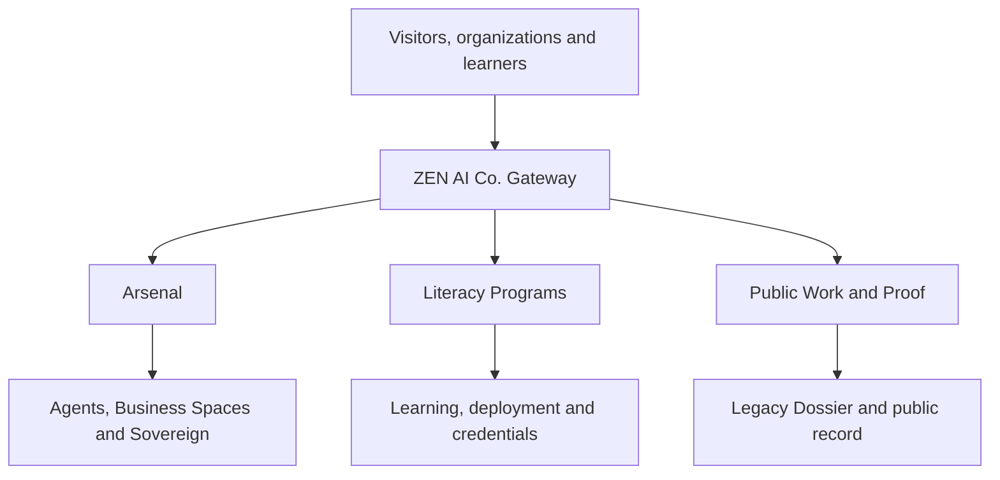

<p align="center">
  <a href="https://www.zenai.world">
    
  </a>
</p>

<h1 align="center">ZEN AI Co.</h1>

<p align="center">
  <strong>Intelligence into capability.</strong>
</p>

<p align="center">
  ZEN AI Co. builds agentic systems for organizations and landmark AI and Web3 literacy programs for people.
</p>

<p align="center">
  <a href="https://www.zenai.world"><strong>ZEN Gateway</strong></a>
  ·
  <a href="https://arsenal.world"><strong>Arsenal</strong></a>
  ·
  <a href="https://www.zenai.world/ai-literacy-constitution"><strong>AI Literacy Constitution</strong></a>
  ·
  <a href="https://www.zenai.world/legacy-dossier"><strong>Legacy Dossier</strong></a>
  ·
  <a href="https://www.zenai.world/work"><strong>Public Work</strong></a>
</p>

---

## Intelligence should become capability

ZEN AI Co. develops practical infrastructure at the intersection of artificial intelligence, automation, education, Web3 and human agency.

The company operates across two connected divisions:

- **Smart Business Solutions** — custom agentic systems, intelligent automation, AI strategy, systems integration and deployable organizational infrastructure.
- **Literacy and Advancement Programs** — project-based learning pathways that help people understand, build, deploy and prove real capability with emerging technology.

ZEN created the **AI Pioneer Program**, the first youth AI literacy program in United States history, and built **Arsenal** as the operating infrastructure for agents, workflows, Business Spaces, files, integrations and deployable AI systems.

The standard across the ecosystem is straightforward:

> **Learn. Build. Deploy. Prove.**

## The ZEN ecosystem

| Surface | Purpose |
| --- | --- |
| [**ZEN Gateway**](https://www.zenai.world) | The public entrance to ZEN AI Co., its solutions, programs, proof and partnerships. |
| [**Arsenal**](https://arsenal.world) | Agentic operating infrastructure for building and deploying agents, workflows and Business Spaces. |
| **Arsenal Sovereign** | A device-adaptive local AI worker system for private, client-resident agent execution. |
| **AI Pioneer Program** | Project-based youth AI literacy centered on building and deploying real systems. |
| **Vanguard** | ZEN's Web3 literacy and emerging-technology advancement program. |
| [**AI Literacy Constitution**](https://www.zenai.world/ai-literacy-constitution) | ZEN's public charter for measurable, human-led AI literacy. |
| [**Public Work**](https://www.zenai.world/work) | Accomplishments, initiatives, partnerships and published knowledge. |
| [**ZEN Legacy Dossier**](https://www.zenai.world/legacy-dossier) | The evidence-preservation and public-record layer for ZEN's historical work. |

## How the gateway connects the company



The gateway is not intended to duplicate every product. It routes each person to the correct ZEN capability while preserving a unified company identity.

## What this repository contains

This repository contains the public application for **zenai.world**.

Core surfaces include:

- A responsive company gateway and ecosystem map.
- Smart Business Solutions and literacy-program positioning.
- Arsenal and Arsenal Sovereign entry points.
- Managed navigation, pages and announcement surfaces powered by the ZEN/Arsenal content control plane.
- Public work, accomplishment, initiative, partner and knowledge pages.
- A structured “Start with ZEN” intake experience.
- The AI Literacy Constitution.
- The ZEN Legacy Dossier and field gallery.
- Privacy, terms, refund and accessibility pages.
- Search metadata, Open Graph assets, sitemap generation and robots directives.
- Privacy-limited site analytics.
- Sandboxed rendering for managed HTML and embedded public experiences.
- Legacy-route handling for continuity after the Wix migration.

## Technology

| Layer | Implementation |
| --- | --- |
| Application | Next.js App Router, React and TypeScript |
| Runtime | Vinext on a Cloudflare Worker-compatible runtime |
| Build system | Vite |
| Hosting | OpenAI Sites with custom-domain delivery |
| Managed content | Arsenal/Supabase public content surfaces |
| Data tooling | Drizzle ORM with optional D1 support |
| Analytics | Privacy-limited GA4 event instrumentation |
| Testing | Node test runner with production-render verification |

## Repository map

| Path | Responsibility |
| --- | --- |
| [`app/`](./app) | Routes, page components, managed content, analytics and the ZEN visual system |
| [`app/work/`](./app/work) | Public work listings and publication rendering |
| [`app/start/`](./app/start) | Guided ZEN intake experience |
| [`worker/`](./worker) | Worker entry point, runtime bindings, redirects and image delivery |
| [`public/`](./public) | Brand assets, social media imagery, gallery media and public records |
| [`db/`](./db) | Database schema entry point |
| [`drizzle/`](./drizzle) | Generated database migration metadata |
| [`tests/`](./tests) | Rendered production-surface and integration checks |
| [`.openai/hosting.json`](./.openai/hosting.json) | Sites project and optional binding declaration |

## Local development

### Requirements

- Node.js **22.13.0 or newer**
- npm

### Start the application

```bash
git clone https://github.com/Bluenot3/zen-ai-literacy-constitution.git
cd zen-ai-literacy-constitution
npm ci
npm run dev
```

The local development server will report the preview URL after startup.

### Validate a change

```bash
npm run lint
npm test
```

The test command builds the production application and verifies the rendered ZEN gateway, managed content contracts, public archive, legal surfaces and legacy behavior.

## Runtime configuration

The application can use the following production or local environment variables:

| Variable | Purpose |
| --- | --- |
| `SUPABASE_URL` | Base URL for the Arsenal/ZEN managed-content data service |
| `SUPABASE_PUBLISHABLE_KEY` | Public client credential for approved public RPC and publication reads |

Environment variables belong in the hosting platform or ignored local `.env*` files. **Never commit secrets, service-role keys, private customer data or production credentials.**

When managed-content configuration is unavailable, the application retains its built-in public gateway rather than exposing private data or credentials.

## Publishing and deployment

Strategic sequencing and the 12-month operating plan are governed by the [ZEN Power Ascent HQ — Source of Truth](https://app.notion.com/p/ZEN-Power-Ascent-HQ-Source-of-Truth-3d86ba60d6934c85b626e07450d5ce89?source=copy_link). Production/runtime facts and verified repository evidence remain authoritative for current implementation truth. Engineering release state is maintained in the single Arsenal final-ascent execution ledger rather than duplicated here.

Production is delivered through OpenAI Sites and the custom ZEN domain.

Every release should:

1. Begin from a reviewed GitHub commit.
2. Pass lint and production-render tests.
3. Preserve or intentionally redirect historical public URLs.
4. Confirm mobile navigation, authentication destinations and external links.
5. Validate the sitemap, social metadata and public legal pages.
6. Save a traceable Sites version before production deployment.
7. Retain a known-good version for rollback.

The production homepage is [https://www.zenai.world](https://www.zenai.world).

## Security and privacy principles

- Public content access must be enforced server-side through explicit public RPCs, database permissions and row-level security.
- Draft, private, administrative and entitlement-controlled data must never rely on client-side filtering.
- Managed HTML and embeds must remain sandboxed and narrowly permissioned.
- Authentication return paths must be same-origin or explicitly allowlisted.
- Analytics must not collect intake answers, prompts, credentials, query-string secrets or private records.
- Historical claims and public evidence should remain source-backed and preserved through the Legacy Dossier.
- Never submit passwords, API keys, health information or sensitive customer records through public intake forms.

Security concerns may be reported privately to [huxley@zenai.biz](mailto:huxley@zenai.biz).

## Development standards

Before proposing a production change:

- Keep the public gateway functional without optional managed-content services.
- Test narrow mobile layouts and keyboard navigation.
- Respect `prefers-reduced-motion`.
- Preserve semantic headings, accessible names and visible focus states.
- Add redirects when replacing an indexed route.
- Update metadata and sitemap behavior when adding a public page.
- Avoid unsupported historical, scientific or product-performance claims.
- Keep external product destinations configurable and measurable.
- Do not expose proprietary credentials, customer information or administrative interfaces.

## Repository scope

This repository covers the **ZEN AI Co. public gateway**. It does not contain the complete private source for every ZEN product, Arsenal service, course database, integration or credentialing system.

Public visibility of this repository does not grant permission to use ZEN names, trademarks, visual identity, curriculum, private systems or proprietary product materials.

## Official channels

- Website: [zenai.world](https://www.zenai.world)
- Arsenal: [arsenal.world](https://arsenal.world)
- LinkedIn: [ZEN AI Co.](https://www.linkedin.com/company/z3nai/)
- X: [@ZEN_AGI](https://x.com/ZEN_AGI)
- YouTube: [@ZENAIML](https://www.youtube.com/@ZENAIML)
- Contact: [huxley@zenai.biz](mailto:huxley@zenai.biz)

---

<p align="center">
  <strong>Build the systems. Prepare the people. Advance human capability.</strong>
</p>

<p align="center">
  © 2026 ZEN AI Co. All rights reserved.
</p>
